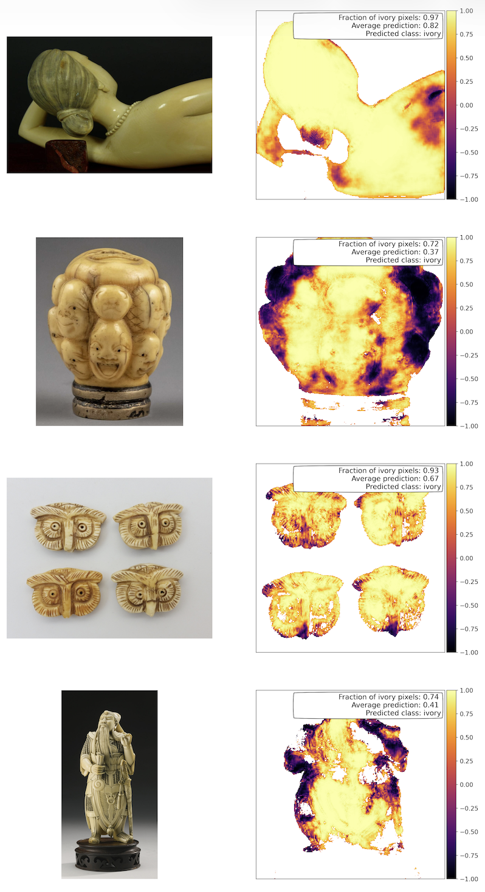

<table>
<tr>
<td width="220" valign="top">
  
</td>
<td valign="top">

# Ivory Agentic Repository 

AIvory is a set of machine learning and agentic AI tools for performing image analysis to detect illegal wildlife trade images. In particular, it contains a set of tools for detecting and classifying images of illegal ivory and distinguishing them from bone carving objects: 
- A U-Net image segmentation model designed to distinguish ivory objects from bone at pixel-level 
- A set of agentic AI tools designed to assist illegal wildlife image detection and classification. 

</td>
</tr>
</table>

## Example notebooks:

- `examples/agentic_llm_workflows.ipynb`: An illustration of agentic AI applications to image segmentation tasks, e.g., detecting required objects in images to prepare for machine learning image segmentation or to provide LLM textual descriptions for a given object. 
- `examples/Ivory_training_with_ROC.py`: The main training script that reproduces the results presented in Mozzon et al. 2026. This includes the key training scripts along with the statistical analysis.
- `examples/ivory_agentic_comparison.ipynb`: This script contains the main comparison between the U-net classification results and a corresponding agentic AI classification for the same test images.
- `examples/ml_resnet34_inference.ipynb`: This demonstrates the U-net image segmentation model performance on unseen test images. 

## Quick Start + API code setup:

Note that the scripts that use LLMs/agentic AI require you to load Google/Anthropic/OpenAI API key to work.

```bash
cd github_repo
python -m pip install -r requirements.txt
python -m pip install -e .
# In case you get an error message related to plum-disptch, also run the following:
python -m pip install --force-reinstall --no-cache-dir plum-dispatch
export GOOGLE_API_KEY="..."
export ANTHROPIC_API_KEY="..."
```

## Example Results
<p align="center">
  
</p>