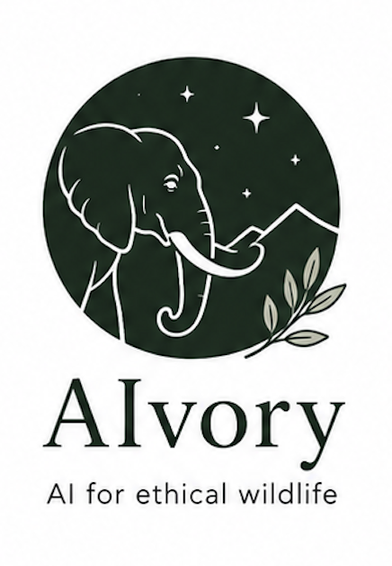

<table>
<tr>
<td width="240" valign="top">
  
</td>
<td valign="top">

# Ivory Agentic Repository 

AIvory is a set of machine learning and agentic AI tools for performing image analysis to detect illegal wildlife trade images. In particular, it contains a set of tools for detecting and classifying images of illegal ivory and distinguishing them from bone carving objects. 

</td>
</tr>
</table>

## Example notebooks:

- `src/ivory_repo/ml.py`: ResNet34 + fastai image segmentation code for distinguishing ivory from bone objects.
- `src/ivory_repo/llm.py`: A selection of agentic LLM tools for assisting with image segmentation tasks.
- `examples/ml_resnet34_inference.ipynb`: Pixel-level image segmentation using a saved ResNet34 model.
- `examples/ivory_agentic_comparison.ipynb`: Ivory-bone image classification using a ResNet34 model and an LLM.

## Quick Start + API code setup:

```bash
cd github_repo
python -m pip install -r requirements.txt
python -m pip install -e .
# In case you get an error message related to plum-disptch, also run the following:
python -m pip install --force-reinstall --no-cache-dir plum-dispatch
export GOOGLE_API_KEY="..."
export ANTHROPIC_API_KEY="..."
```

## Example Results


*Example segmentation and classification results on ivory samples*